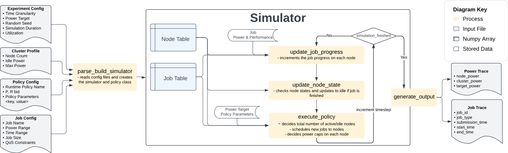
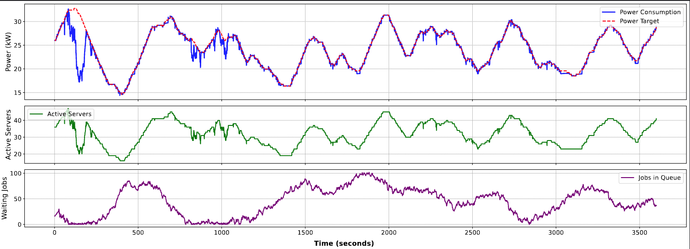

# FlexDC-Sim

## Introduction

**FlexDC-Sim** is an open-source, data center demand response simulator designed to evaluate power management strategies and demand response (DR) programs on data centers. FlexDC-Sim can quickly evaluate the performance, power, and cost implications of participating in various DR programs. 

The simulation flow of FlexDC-Sim is shown in the following image.

<!--  -->


FlexDC-Sim is licensed under BSD 3-Clause License. Please cite the following research paper if you use FlexDC-Sim:

Fatih Acun, Can Hankendi, Ethan Levine, Hudson Reynolds, Joshua Bardwick, and Ayse K. Coskun. 2026. Investigating Power Consumption Flexibility of AI Data Centers for Demand Response Participation. In The 17th ACM International Conference on Future and Sustainable Energy Systems (E-Energy ’26), June 22–25, 2026, Banff, AB, Canada. ACM, New York, NY, USA, 5 pages. https://doi.org/10.1145/3744255.3798112


### Simulator Input

The simulation input consists of multiple configuration files to provide an organized experimentation environment for users. 
- Experiment config stores experiment-specific information such as the duration of the experiment, the power target for the simulation, and utilization of the cluster. 
- Policy config includes the power management and bidding policy-related parameters and allows storing parameters of custom user-defined policies by having a key-value structure. 
- Job config includes application-related metadata such as power performance profiling and QoS constraints.

### Simulation Flow of FlexDC-Sim
The simulation flow includes updating the job progress scheduled on each node for a certain timestep, updating the states of nodes upon job completion, and executing the DR participation policy to schedule new jobs to nodes and apply power caps depending on the received power target.

To store the data center state, FlexDC-Sim keeps two key data structures throughout the simulation, **node table** and **job table**. 
- In **node table**, we store each node’s state (e.g., idle or active), power consumption, power cap, and the progress of jobs currently running on the nodes. We use the power consumption data from the node table to feed our power management policies to track power targets during the simulation. 
- In **job table**, we store the job scheduling and execution information to report performance-related metrics after the simulation completes. We implement the job table and node table using NumPy arrays to allow fast and parallel execution of frequent updates and queries.

### Output:
After each simulation, we save the results into **Power Trace** and **Job Trace** files. 

- **Power trace** stores the timely power consumption of each node in the cluster, as well as the cluster-level power target. We use power trace to assess the data center performance on DR program participation, such as evaluating how closely it tracks the power targets.

- **Job trace** includes all job submissions, job types, and start and end times of job executions during the simulation time. We calculate the QoS degradations using the job table to assess the impact of applying power management and scheduling policies on application and cluster-level performance.


# Getting Started With Development
1. Install **Python 3.10** 
- Example for Linux:
```
sudo add-apt-repository ppa:deadsnakes/ppa -y
sudo apt update
sudo apt install python3.10 python3.10-venv python3.10-dev -y
```

2. Clone the repository:
```
git clone git@github.com:peaclab/flexdc-sim.git
cd flexdc-sim/
```

3. Create a virtual environment:
```
python3 -m venv --prompt peacsim venv
```

4. Activate the virtual environment every time you start a new development session:
```
source venv/bin/activate
```

5. Upgrade pip:
```
pip install --upgrade pip
```

6. Use editable mode to avoid modifying PYTHONPATH:
```
pip install -e .
```

7. Install the required packages
```
pip install -r requirements.txt
```

### Now that your environment is set up, here is what to know: 
- **run_simulator.py** sets up and runs a simulation (***src/peacsim/***)
    - **Input:** configuration files are passed as command line arguments.
    - Config files are stored in the ***configs/*** folder. Essential configs for simulation:
        - --experiment-config
        - --policy-config
        - --cluster-config
        - --job-config
    - The power trace stored in ***data/ISO24h.csv*** is the signal from the power provider
    - **Output:** Simulations will output a **power trace** and **job trace** in csv files in ***src/peacsim/output/simulation/***
    - **Graph**: the ***plot_simulation*** notebook in ***src/peacsim/notebooks/*** reads the traces
- **run_optimizer.py** repeatedly constructs and runs simulations to optimize hyperparameters. See [Optimization Section](#optimizing-demand-response-parameters).

### Make sure everything is working by running a short example experiment:
1. Run a simulation to make sure everything is working:
```
cd src/peacsim/
python3 run_simulator.py --experiment-config ../../configs/experiment/exp_low_util.ini --cluster-config ../../configs/cluster/cluster.ini --policy-config ../../configs/policy/example_flexDC_simulation.ini --job-config ../../configs/workload/W2-short-qos3445.ini --output-dir W2-simulated_annealing_low_util_availability=True_50server
```
After the simulation, results are saved in a directory under src/peacsim/output/simulation. The specific name of the result directory for a simulation is printed at the end similar to the following:

```
Results saved in: output/simulation/W2-simulated_annealing_low_util_availability=True_50server_20260225114542/
```

2. Plot your results: , and change the path at the top to the output directory that previous simulation is saved. 
```
python3 notebooks/plot_simulation.py --simulation-output output/simulation/W2-simulated_annealing_low_util_availability=True_50server_20260225114542
```
You should see this plot:
<!--  -->


You can further explore plotting by investigating the jupyter notebooks in the notebooks folder.

# Optimizing Demand Response Parameters
We use a simulated annealing optimization approach implemented that incorporates cost schemes from different DR programs and data center policies. 
- The optimization builds up on iteratively executing and updating the parameters for calculated costs from the results of the simulations. 
- Weights & Biases is an optional plug-in to allow users to track and easily compare their optimization experiments for various configurations.

#### Example run command for **simulated_annealing.py**:
```
python3 simulated_annealing.py --experiment-config ../../configs/experiment/exp_low_util.ini --cluster-config ../../configs/cluster/cluster.ini --job-config ../../configs/workload/W2-short-qos5555.ini --gradient-config ../../configs/optimization/simulated_annealing/SA_low_util_RSR.ini --policy-name AQA --output-dir W2-AI-simulated_annealing_low_util
```